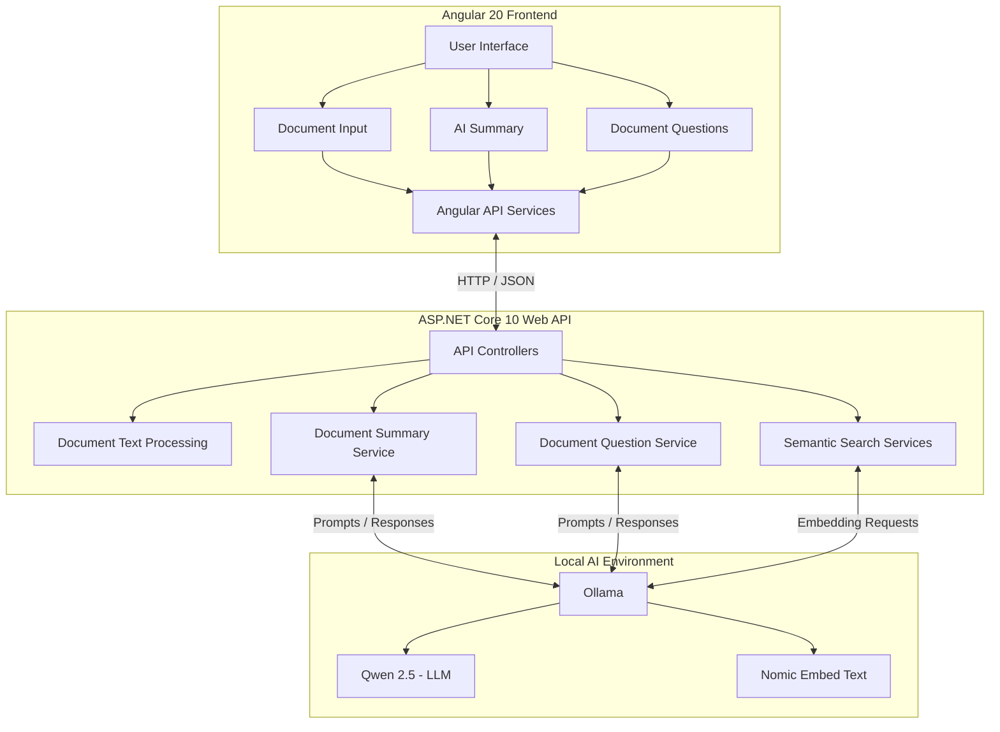
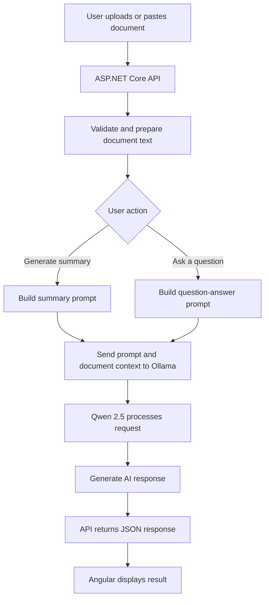

# AI Document Assistant

An AI-powered document assistant built with **Angular 20, ASP.NET Core 10, and Ollama**. Upload or paste a document, generate an AI summary, and ask questions about its contents.

This project explores practical applications of Large Language Models (LLMs), including document processing, prompt engineering, embeddings, and semantic search.

## Features

- **Document input:** Upload text files or paste document content.
- **Text preparation:** Validate and prepare document text for AI processing.
- **AI summaries:** Generate concise summaries using a locally hosted language model.
- **Document questions:** Ask questions about document content and receive AI-generated, document-grounded answers.
- **Local AI:** Run language models locally using Ollama without requiring a paid cloud AI API.
- **Semantic search foundation:** Includes document chunking, text embeddings, cosine similarity, and semantic search services.
- **Automated testing:** Unit tests covering API and application service functionality.

## Technology Stack

| Area | Technology |
|---|---|
| Frontend | Angular 20, TypeScript |
| Backend | ASP.NET Core Web API, .NET 10 |
| AI Runtime | Ollama |
| Language Model | Qwen 2.5 |
| Embeddings | Nomic Embed Text |
| Testing | xUnit |
| Development | Visual Studio Code |

## Architecture

The application uses an Angular frontend that communicates with an ASP.NET Core Web API. The API handles document processing and coordinates AI requests through Ollama.

### System Architecture



### Document Processing Workflow

The following diagram illustrates the primary document interaction workflow.



## Prerequisites

Install the following:

- [.NET 10 SDK](https://dotnet.microsoft.com/download/dotnet/10.0)
- [Node.js](https://nodejs.org/)
- [Angular CLI](https://angular.dev/tools/cli)
- [Ollama](https://ollama.com/)

## Running Locally

### 1. Download the AI Models

Install and start Ollama, then download the required models:

```powershell
ollama pull qwen2.5:3b
ollama pull nomic-embed-text
```

Ollama should be available at:

```text
http://localhost:11434
```

### 2. Start the ASP.NET Core API

From the solution root:

```powershell
dotnet run --project src/AiDocumentAssistant.Api --launch-profile http
```

The API will run at:

```text
http://localhost:5034
```

### 3. Start the Angular Application

Open a separate terminal:

```powershell
cd client
npm install
npm start
```

Open the application in your browser:

```text
http://localhost:4200
```

## Running Tests

From the solution root:

```powershell
dotnet test
```

The project uses xUnit for automated testing.

## Project Structure

```text
AiDocumentAssistant/
|
+-- client/                     Angular frontend
|
+-- src/
|   +-- AiDocumentAssistant.Api/
|       +-- Controllers/
|       +-- Services/
|
+-- tests/
|   +-- AiDocumentAssistant.Tests/
|
+-- AiDocumentAssistant.sln
+-- .gitignore
+-- README.md
```

## Project Goals

This project is part of my ongoing exploration of AI application development.

Areas of focus include:

- Integrating LLMs into existing application architectures.
- Building APIs that interact with language models.
- Preparing documents for AI processing.
- Implementing document-grounded question answering.
- Using embeddings and vector similarity for semantic search.
- Writing automated tests for AI application services.
- Building practical AI applications using .NET and Angular.

---

**Status:** Active Development